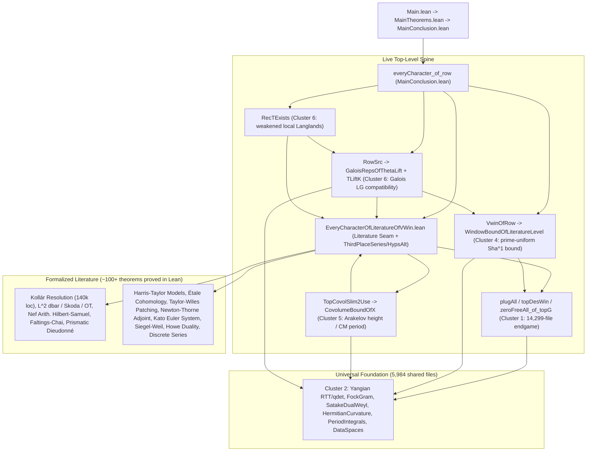

# Structural Atlas (Level 0): End-to-End Architecture Spine of `lean/src/`

*Synthesized empirically from [stage0_graph_map.md](file:///home/marcus/GitHub/mbintz/incandescent/atlas/stage0_graph_map.md) and the six unconstrained Wave 1 field notes (Clusters 1, 3, 5 by Claude Opus 5.5 `xhigh`; Clusters 2, 4, 6 by GPT-6.2-Astra `xhigh`). Every file path is relative to `lean/src/` unless linked with `file://`.*

---

## 1. Global Map & The Live Entry Path

All **175,187** `.lean` files in `lean/src/` are reachable from [Main.lean](file:///home/marcus/GitHub/mbintz/incandescent/lean/src/Main.lean) (**0 unreachable files**, **0 `sorry`**, **0 top-level `axiom`**):
- **175,179** files feed [MainTheorems.lean](file:///home/marcus/GitHub/mbintz/incandescent/lean/src/Supplements/Kernels/MainTheorems.lean) (RH and GRH for all Dirichlet $L$-functions); the remaining 8 are `SmallClassNumbers` corollaries.
- Right below [MainConclusion.lean](file:///home/marcus/GitHub/mbintz/incandescent/lean/src/Development/AutomorphicArithmetic/CharacterBoxes/MainConclusion.lean), the proof splits along an **explicit machine-readable seam** (`OpenLiteratureStatements`, `PublishedHodgeBundleTheorems`, `ThetaLocalInputs`, `LiteratureAutomorphyHypothesis`) separating the **core GRH machine** from ~100+ classical and modern theorems proved from scratch inside Lean.
- **Key structural discovery (Cluster 3 ↔ Cluster 6):** `EveryCharacterE.lean` (`hypsE₂` / `everyE₂`) actually has **zero callers**—it remains in the import graph solely because `EveryCharacterOfLiteratureOfVWin.lean` reaches `moriwakiBig_outright` and `hsUse_outright` through `EveryCharacterE → ArakSwapCovol → Outright.lean`. The **live** assembly runs through a 2,251-file cloned pipeline in `ThirdPlaceSeries/` (`SiegelEisensteinSecondTermHypotheses.lean`, using `HypsAlt`), created specifically to replace full `LocalLanglandsGL` with the weakened `RecTExists` and `CovolX` with `CovolumeBoundOfX`.
- **Scaffolding vs. substance:** Roughly **34%** of the large exclusive cones (~14,308 files in Cluster 3 alone) are mechanical one-line re-export wrappers (`first | exact @X | exact X | ...`), and directory names in `Development/AbelianVarietyTheory/Proofs/` often do not match file contents (e.g., `IwasawaDecomposition/` holds Galois reps and idempotents). File names and theorem types are the reliable map.

---

## 2. How an Off-Line Zero Is Driven to a Contradiction

Every major subsystem exists to execute **one six-step analytic–arithmetic chain** (decoded across Clusters 1–6):

### Step 1 — Localized Landau Window Contradiction (Cluster 1)
Fix a primitive Dirichlet character $\psi$ of order $o$, and form the positive-coefficient cyclic combination of smoothed Chebyshev remainders:
$$\mathrm{Gm}_{\langle\psi\rangle}(y) = G(y) + \frac{1}{3o+1}\sum_{\chi \in \langle\psi\rangle \setminus \{1\}} \operatorname{Re} g_\chi(y), \qquad g_\chi(y) = \sum_{n \le y}\Lambda(n)\chi(n)\!\left(\frac{y}{n}-1\right) + y\,\frac{L'}{L}(1,\chi).$$
The localized Landau–Pintz theorem `formB` ([ZeroFreeOfRpowWindow.lean](file:///home/marcus/GitHub/mbintz/incandescent/lean/src/Development/AutomorphicArithmetic/DedekindLFunctions/LandauTheorems/ZeroFreeOfRpowWindow.lean)) proves that **one-sided bounds** $\mathrm{Gm}_{\langle\psi\rangle}(y) \le y^\theta$ on **sparse multiplicative windows** $[Y, Y^{3/2}]$ for arbitrarily large $Y$ forbid any zero of $L(s,\psi^k)$ with $\operatorname{Re} s > \theta$. Driving $\theta = \tfrac{1}{2} + 9\varepsilon$ below any putative off-line zero $\operatorname{Re}\rho > \tfrac{1}{2}$ gives GRH.

### Step 2 — Host CM Field $E/\mathbb{Q}$ & The Huge-Conductor Twist Trick (Cluster 1)
For scale $x$ and small $\varepsilon \in (0, 1/52)$, build a Galois CM abelian field $E/\mathbb{Q}$ of degree $[E:\mathbb{Q}] = 4n$ ($n \approx x^{2+8\varepsilon}$) cut out by $\zeta_{2^{a(x)+2}}$, $\psi$, and **two auxiliary primes** $q \equiv 3 \pmod 8$, $d \equiv 7 \pmod{16}$ ($q \mid d+1$, and $p \mid d+1$ for all odd $p \le Y^{\varepsilon/5}$) with:
$$\log q \approx Y^{\varepsilon/5}, \qquad \log d \approx Y^{\varepsilon/5}\log^2 Y.$$
- **Why this works:** Characters of $E$ split into *kept* ($\langle\psi\rangle$) and *bounded* (all others). Every bounded character carries a twist $(\cdot/q)^i(\cdot/d)^j$ with $(i,j)\ne(0,0)$, so its conductor is $\approx \exp(x^{\varepsilon/5}) \gg x$. At the single scale $x$, RH-strength bounds $\|g_\chi(y)\| \le y^{1/2+\varepsilon/2}$ for those characters are a **short-sum mean-square / large-sieve fact** (`QH.pairEx`, proved by averaging over $(q, d)$).
- **Fourier-weight coset isolator:** Choosing a test set `TT` hitting $A_0$-cosets with frequency $4/(3o+1)$ vs. $3/(3o+1)$ has Fourier transform $1$ on trivial and $1/(3o+1)$ on nontrivial characters, turning the exact inert-prime balance identity $\mathrm{ASK} - \mathrm{MAIN} = \mathrm{De}$ (`colour_balance`) directly into an upper bound on $\mathrm{Gm}_{\langle\psi\rangle}(x)$.

### Step 3 — The Pure-Real 11-Hypothesis Slope Inequality Engine (Cluster 1)
Inside `Formalism/RankGapBounds/MeanBoundSecondForm.lean`, a pure real-number `linarith` engine chains four inequalities over lifts $j=1,\dots,m$ and words $u \in W(u_0)$:
$$\underbrace{\mathrm{ASK}}_{\text{inert-prime count}} \;\le\; \underbrace{\mathrm{Gain} + \mathrm{LoP}}_{\texttt{LinkG}} \;\le\; \underbrace{\text{mean slope } s}_{\texttt{SlopesN}} \;\lesssim\; \underbrace{\mu_{\mathrm{CC}} + \text{entropy}(\delta,\eta,e)}_{\texttt{LinkS} + \texttt{LinkIRR}} \;\le\; \underbrace{\mathrm{MAIN} + \text{error}}_{\texttt{LinkDIV} + \texttt{CovolX}}.$$
- **Exact cancellation to `MAIN`:** The degree upper bound (`DIV`) carries $\log\Omega = \gamma + \log(\pi/v) - L'(1,\chi_{-d})/L(1,\chi_{-d})$ (the abelian Colmez/Chowla–Selberg CM period); the $\pm m a \log(\pi/v)$ and local $E_{e,j}$ terms cancel against the prime-level count $\log T_u$, leaving **exactly** $\mathrm{MAIN}$!
- **Where $\tfrac{1}{2}$ comes from:** Not from a hidden spectral gap, but from balancing the engine's normalized error $a(1+m^2/k)/(mb) \approx x/m$ by choosing **$m \approx x^{1/2-\varepsilon/16}$** (while $k \approx x^{9/2+10\varepsilon}$ and $n \approx x^{2+8\varepsilon}$).

### Step 4 — Synchronized Scale Budget (Why Every Cluster Lives at Scale $b = e^{x^\varepsilon}$)
All six clusters lock together around a single exponential buffer $b = \exp(x^\varepsilon)$:

| Parameter | Scale | Why this exact size (cross-cluster origin) |
|---|---|---|
| $L = x^\varepsilon$, $b = e^{x^\varepsilon}$ | Exponential buffer | Simultaneously swamps `CovolX`'s $O(b)$ deep-cover comparison loss (`RingAt`/`MapsAt`, Cluster 5) **and** `VWin`'s $\sqrt{b}$ Galois $\mathrm{Sha}^1$ budget (Cluster 4). |
| $a = x b = x e^{x^\varepsilon}$ | Prime-count height | Dividing by $n_T m b$ cancels $b$ completely, leaving normalized error $x/m \approx x^{1/2}$ (Cluster 1). |
| $m \approx x^{1/2 - \varepsilon/16}$ | Lift count / tower height | Sets the final zero-free exponent $\frac{1}{2} + 9\varepsilon$ (Cluster 1). |
| $n \approx x^{2 + 8\varepsilon}$ | Host degree parameter ($[E:\mathbb{Q}]=4n$) | Forced by `SizeKRel` / `rankBudget` ($2nm^5 x^{2\varepsilon+\tau} \le k \le m n^2 x^{-2\varepsilon} \implies n \ge 2m^4 x^{4\varepsilon+\tau}$). |
| $k \approx x^{9/2 + 10\varepsilon}$ | Base Hermitian rank | Must absorb the label-injection counting bound while staying below $m n^2 x^{-2\varepsilon}$. |
| $t \le \lfloor x^{401} \rfloor$ | Twist cutoff in `VWin` | Host rank satisfies $R.t \le 10576\, x^{399.67} \le x^{400}$, plus $+1$ for rescaling $(kx')^{400} \le (x')^{401}$ (Cluster 4). |
| $\delta \le 3 e^{-x^{\varepsilon/(7J)}}$ | Bad rank fraction (`LinkIRR`/`BadAt`) | Exponentially small so $12\delta Q \le E$ kills polynomial-in-$x$ slope ranges $Q = x^A E$ (Clusters 1, 5). |

### Step 5 — How the Four Pillars Discharge the Nine Links
1. **Automorphic Window `VWin` (Cluster 4):** `LinkN` bounds the twisted local $\eta$-defect by $\sum_\ell \log\ell \sum_{1\le j < t} \operatorname{length}_{\mathbb{Z}_\ell}\mathrm{Sha}^1(E,\mathbb{Q}_\ell/\mathbb{Z}_\ell(-j))$. `VWin` proves this sum is $\le \sqrt{\exp(x^\varepsilon)}$ uniformly across **all primes $\ell$** on a scale window $[Y, Y^2]$:
   - Deformation-ring cotangent lengths (`LemmaM`/`LemmaM'`) are bounded by $2\sum_{\rho\in X} v_\ell(\operatorname{tr}\rho(\sigma) - T)$.
   - Taylor–Wiles patching + Newton–Thorne adjoint Bloch–Kato vanishing + Kato Euler system (`KatoTwoW`) restrict deformation points to finite automorphic families ($U(3)$ and $\mathrm{GSp}_4$) with bounded traces ($|t_s| \le 3$).
   - For unbounded primes $\ell$ (Case I), multiplying $Q^e(t_s - (Q^{-e}z+1+Q^e z^{-1}))$ across all $s$ and Galois-conjugate roots $z$ produces **one single nonzero integer $n \in \mathbb{Z}$** controlling all $\ell$ simultaneously via $\sum_{\ell\in S} v_\ell(n)\log\ell \le \log|n|$.
   - Ferrero–Washington + `LemmaK` ($\log\#H^2 \le \exp((2en)^{C_K}\log(2|\operatorname{disc}L|))$) leave $\le R$ bad twist indices; a pigeonhole induction (`Window.lean`) extracts $[Y, Y^2] \subset [X^{1/J}, X]$ avoiding them all.
2. **Yangian / Fock / Curvature / Mass Hub (Cluster 2):** Supplies the harmonic-analytic and integral-representation engine underneath `LinkS` (near-orthonormality of Gram matrices), `LinkDIV`, and `LinkG`:
   - **Yangian `qdet` (#1 repo hub):** Labels discrete-series representations by $\prod_j(u-j+\nu_j)$, splits restrictions via the quantum comatrix identity (`CapSp` / `QComatrix`), and becomes an explicit scalar radial eigenvalue $GG(g)x_\rho(Y)$ on Bessel cells $G = |D_{r+1}|^2 - T_z T_{z'} |D_r|^2$.
   - **Second $2\times 2$ RTT engine (`YangianSpanCharacter`):** Word fusion, RTT sandwiches, and scalar-test separation drive `OscillatoryIntegralBounds` in `SharpRestriction`.
   - **Hermitian tower (`DataSpaces`):** Definite spaces $X_j$ (rank $k+j(t+1)$), indefinite spaces $Y_j$ (signature $(r+jt-q_j, q_j)$ with $Y_0 \simeq X_0 \perp \langle -T\rangle \perp H^s$, reversing inclusion $Y_m \simeq X' \hookrightarrow X_m$ at the top), and definite adelic-twin spaces $W_j$.
   - **Integral & mass bounds:** `SharpRecursion` accumulates tower errors ($80(r+1)(\varepsilon+a)$); `PieriBlockIdeals` bounds localized $\ell$-exponents killing $\nabla_\nu/\Delta_\nu$; `SiegelMassRatio` supplies rank-ratio counting bounds (`LoopsCut`, threshold $408e\pi$).
3. **Theta Grids, Rationality & Global Interpolation (Cluster 3):** Assembles the 46-field `Hyps` / `HypsAlt` package:
   - 2D Fock-model theta grids (`GridData`/`GridA`) obeying Kudla–Rallis `StepAlpha`/`StepBeta` $L$-value tower relations.
   - Theta rationality via `FunctionalsSeparate` (fed by an outright quantitative archimedean $U(n+1)\supset U(n)$ discrete-series branching theorem `RealInputE`).
   - Stuhler–Grayson Harder–Narasimhan slope bounds (`FUN`, `L3`, `ON`), transported across family selections by **genericity via algebraic finiteness** (`large₂`/`EvLgG`/`GKeyFin`), with hand-rolled bounds at primes $2, 3$ (`BoundAtTwoAndThreeForFamily`) and full integral $p$-adic Hodge theory (Breuil–Kisin, $A_{\inf}$, Wach modules).
4. **Arakelov Covolume & CM Period `CovolX` (Cluster 5):** Proves the lower bound on the Arakelov degree of the integral lift lattices $M_j$ whose main term is the Hodge-weighted CM period $\log\Omega$:
   - Layer A: standalone Hermitian-lattice `goodBadCut` ($\mu(L\cap\operatorname{im}e) \ge \mu(L) - 12\delta Q$).
   - Layer B: Bost-type slope transfer on level-$15^e$ covers of unitary Shimura varieties, introducing $\log\Omega$ via flat sections (abelian tame Colmez formula from prismatic Dieudonné theory) + effective arithmetic Hilbert–Samuel (Minkowski + Bergman + Fubini–Study, **no analytic torsion**).
   - Layer C: `DeepStR` averaged arithmetic-volume lower bound from Kollár's functorial char-0 resolution (499 files / 140k loc), Hörmander/Skoda/Ohsawa–Takegoshi $L^2$-$\bar\partial$ extension from finite point sets on Stein Riemann domains (227 files), Moriwaki bigness, Fargues Hodge–Tate, Zarhin, Grothendieck–Messing, and Faltings–Chai toroidal compactifications.
5. **Galois Representations (`Row0b`) & Weakened Local Langlands (`RecTExists`) (Cluster 6):**
   - **Odd rank:** Harris–Taylor integral models + holomorphic Lefschetz trace formula (`WeightOneGeometricRealization`) gives an annihilating Satake polynomial on a huge cohomology space; a standalone **lacunary Lie-algebra rank-extraction theorem (`DivWCoreLac`)** extracts an exact rank-$a$ subrepresentation.
   - **Even rank:** **Two-lift subtraction (`TLiftK` + `PPeelOne`)**—an explicit adelic Parseval + Rallis theta lift produces *two* odd-rank lifts augmented by disjoint character lists, whose auxiliary lines are peeled off one by one using semisimplicity.
   - **Local Langlands bypass (`RecTExists`):** True LLC on rank-1 (Artin) + twisted depth-zero cuspidals over $\mathbb{Q}_g$ (Green's regular characters), and a **separated dummy wild parameter $J_n$** on all other wild higher-rank cuspidals—kept sound by an asymmetric injectivity law + finite counting converse (`CharPolOfInert`).

---

## 3. Links to Wave 1 Field Notes

- **Stage 0 DAG Cartography:** [stage0_graph_map.md](file:///home/marcus/GitHub/mbintz/incandescent/atlas/stage0_graph_map.md)
- **Cluster 1 (Claude Opus 5.5 `xhigh`):** [01_grh_endgame_and_links.md](file:///home/marcus/GitHub/mbintz/incandescent/atlas/field_notes/01_grh_endgame_and_links.md) — Endgame, Landau window, huge-conductor twist trick, Fourier isolator, 11-hypothesis slope engine, 9 links.
- **Cluster 2 (GPT-6.2-Astra `xhigh`):** [02_yangian_fock_real_places.md](file:///home/marcus/GitHub/mbintz/incandescent/atlas/field_notes/02_yangian_fock_real_places.md) — Yangian RTT/`qdet`, $2\times 2$ Weyl RTT, Fock model, Hermitian tower, curvature recursion, `PieriBlockIdeals`, Siegel mass.
- **Cluster 3 (Claude Opus 5.5 `xhigh`):** [03_hypsE2_theta_and_interpolation.md](file:///home/marcus/GitHub/mbintz/incandescent/atlas/field_notes/03_hypsE2_theta_and_interpolation.md) — Live `ThirdPlaceSeries/HypsAlt` discovery, 2D Fock theta grids, `RealInputE` archimedean branching, HN slopes, `GridA`, primes $2,3$.
- **Cluster 4 (GPT-6.2-Astra `xhigh`):** [04_automorphic_window_vwin.md](file:///home/marcus/GitHub/mbintz/incandescent/atlas/field_notes/04_automorphic_window_vwin.md) — `VWin` as prime-uniform $\mathrm{Sha}^1$ bound, why `401`, four counts, single-integer trace product, patching, pigeonhole scale window.
- **Cluster 5 (Claude Opus 5.5 `xhigh`):** [05_covolume_arakelov_heights.md](file:///home/marcus/GitHub/mbintz/incandescent/atlas/field_notes/05_covolume_arakelov_heights.md) — `CovolX` Arakelov degree bound, `goodBadCut`, `DeepStR`, Kollár resolution, Riemann-domain $L^2$-$\bar\partial$, torsion-free arithmetic Hilbert–Samuel.
- **Cluster 6 (GPT-6.2-Astra `xhigh`):** [06_galois_theta_parseval_and_llc.md](file:///home/marcus/GitHub/mbintz/incandescent/atlas/field_notes/06_galois_theta_parseval_and_llc.md) — `Row0b`, `DivWCoreLac` lacunary rank extraction, two-lift Parseval subtraction, `RecTExists` dummy wild LLC bypass, étale cohomology & $p$-adic Hodge.
