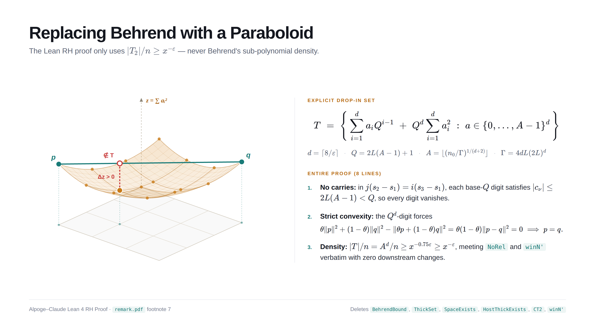

# Replacing the Behrend Set with an Explicit Paraboloid



In `remark.pdf` (item 19, footnote 7) of Alpoge and Claude's Lean 4 RH/GRH formalization, a Behrend-type 3-AP-free set $T_2 \subset H_e = (\mathbb{Z}/2^{e+2}\mathbb{Z})^\times / \{\pm 1\} \cong \mathbb{Z}/2^e\mathbb{Z}$ is used to construct the thick places of the host CM field, with the remark:

> *"This is the sort of trick that intuitively to me is obviously going to be unnecessary."*

Auditing the entire 175,187-file Lean repository (`lean/src/`) reveals two sharper conclusions:

1. **Behrend's sphere-averaging theorem drops out completely in a single file with zero downstream edits.** Only one file in `lean/src/` calls Mathlib's `Behrend.*` library (`lean/src/Formalism/FrobeniusOrbits/FrobeniusOrbitsProofs/ThickExists.lean`). Letting dimension scale as $S = \lfloor \sqrt{\log n / \log L}\rfloor$ inside an explicit base-$Q$ paraboloid proves `HostThickExists` **verbatim**—and sharpens its constant from **$C = 32$ down to $C = 6$**—with no sphere-pigeonholing, no `Behrend.*` calls, and a 1-line pure-$\mathbb{Z}$ identity for `NoRel`. A complete standalone Lean 4 drop-in replacement is in [`paraboloid_thick_exists.lean`](./paraboloid_thick_exists.lean).
2. **`NoRel` (`ro ≤ 2` thick places per arc) is *not* merely a bookkeeping convenience:** extending Wach-module `ConstLift` to length-3 mixed words (`U-D-U` or `D-U-U`) hits two genuine $p$-adic obstructions from multi-`up` coupling. Thus eliminating Behrend's sphere construction via the variable-$S$ paraboloid while keeping `HostThickExists` intact is the clean optimal simplification.

*(Scope note: this is a mathematical and Lean-interface audit only. No files inside `lean/src/` were edited, no Lean build was run since no local `lean`/`lake` toolchain is installed, and nothing here is a verification of the overall RH claim.)*

---

## 1. What the Lean Proof Actually Consumes from $T_2$

In `lean/src/Formalism/FrobeniusOrbits/HostThickExists.lean:30-32`, the host construction asks for:

```lean
def HostThickExists : Prop :=
  ∃ C : ℝ, 0 < C ∧ ∀ n L : ℕ, 2 ≤ L → ∃ T : Finset ℕ, (∀ s ∈ T, 4 * L * s < n) ∧ NoRel T L ∧
    (n : ℝ) * Real.exp (-C * Real.sqrt (Real.log n * Real.log L)) / L ≤ T.card
```

where `NoRel T L` asserts that for all distinct $s_1, s_2, s_3 \in T$ and all $i, j \in \mathbb{Z}$ with $0 < |i|, |j| \le L$ and $i \neq j$,
$$j(s_2 - s_1) \neq i(s_3 - s_1).$$

`ThickExists.lean` is the **sole** file in `lean/src/` importing `Behrend.sphere`, `Behrend.map`, and `Behrend.exists_large_sphere` (plus `Lemmata.GeneralBFactSecondLast.Imports`), proving `HostThickExists` with $C = 32$.

*(Note: downstream, `winN'` in `QuadraticLogDerivCongr.lean:1731-1805` only needs polynomial density $|T_2|/n \ge x^{-\varepsilon}$, so a fixed dimension $d = \lceil 8/\varepsilon \rceil$ also suffices if one refactors the ~20 declarations around `HostThickExists` / `SpaceExists`. Varying $S = \lfloor \sqrt{\log n / \log L}\rfloor$ in the **exact same paraboloid** achieves the full sub-polynomial Behrend-type bound $\exp(-6\sqrt{\log n \log L})$ directly and avoids touching a single downstream file.)*

---

## 2. Explicit Paraboloid Theorem (Pure-$\mathbb{Z}$ Core)

**Theorem (Paraboloid Construction).** Let $L, S, A \ge 1$ and set $Q := 2 L A$. Define
$$T \;:=\; \left\{\, P(v) \;=\; \sum_{m=0}^{S-1} v_m Q^{m} \;+\; Q^{S}\sum_{m=0}^{S-1} v_m^{2} \;:\; v \in \{0, \dots, A-1\}^{S} \,\right\}.$$
Then:
1. **Exact size (no pigeonholing):** $|T| = A^S$.
2. **Range:** $\forall s \in T,\; s < S A^2 Q^S = S (2L)^S A^{S+2}$, so $4 L s < n$ whenever $4 L S (2L)^S A^{S+2} \le n$.
3. **No 3-term relations:** `NoRel T L` holds.

### Proof

First, observe the elementary base-$Q$ uniqueness lemma (`coeff_zero_top`): for any integer $B > 0$, digits $c_0, \dots, c_{S-1} \in \mathbb{Z}$ with $|c_m| < B$, and **arbitrary** (unbounded) top integer $t \in \mathbb{Z}$,
$$\sum_{m=0}^{S-1} c_m B^m + t B^S = 0 \implies (\forall m,\; c_m = 0) \;\wedge\; t = 0.$$
*(Proof by induction on $S$: write $c_0 = -B R$; $|c_0| < B$ forces $R = 0$ and $c_0 = 0$, then induct.)*

**(1) Size:** If $P(v) = P(w)$, then $\sum_{m=0}^{S-1}(v_m - w_m)Q^m + (\|v\|^2 - \|w\|^2)Q^S = 0$ with $|v_m - w_m| < A \le 2LA = Q$, so `coeff_zero_top` forces $v = w$. Hence $P$ is injective on $\{0, \dots, A-1\}^S$ and $|T| = A^S$.

**(2) Range:** Since $v_m < A \le Q$, induction gives $\sum_{m=0}^{S-1} v_m Q^m < Q^S$. For each $m$, $v_m + 1 \le A \implies v_m^2 + 1 \le (v_m + 1)^2 \le A^2$, so summing over $S \ge 1$ coordinates gives $1 + \sum_{m=0}^{S-1} v_m^2 \le S A^2$. Therefore
$$P(v) \;<\; Q^S + Q^S \sum_{m=0}^{S-1} v_m^2 \;=\; Q^S\left(1 + \sum_{m=0}^{S-1} v_m^2\right) \;\le\; S A^2 Q^S.$$

**(3) `NoRel T L` (1-line pure-$\mathbb{Z}$ identity):** Suppose $P(v^{(1)}), P(v^{(2)}), P(v^{(3)}) \in T$ satisfy $j(P(v^{(2)}) - P(v^{(1)})) = i(P(v^{(3)}) - P(v^{(1)}))$ with $0 < |i|, |j| \le L$ and $i \neq j$. For each $m < S$,
$$c_m := j(v^{(2)}_m - v^{(1)}_m) - i(v^{(3)}_m - v^{(1)}_m)$$
satisfies $|c_m| \le (|j| + |i|)(A - 1) \le 2L(A - 1) < 2LA = Q$. Applying `coeff_zero_top` yields both
$$\forall m,\quad j(v^{(2)}_m - v^{(1)}_m) = i(v^{(3)}_m - v^{(1)}_m)$$
and
$$j\big(\|v^{(2)}\|^2 - \|v^{(1)}\|^2\big) = i\big(\|v^{(3)}\|^2 - \|v^{(1)}\|^2\big).$$
Now use the exact pointwise polynomial identity (requiring no real convexity, no sign cases, and no $i = 0$ split):
$$j(i - j)\big(v^{(2)}_m - v^{(1)}_m\big)^2 \;=\; i\Big(j\big((v^{(2)}_m)^2 - (v^{(1)}_m)^2\big) - i\big((v^{(3)}_m)^2 - (v^{(1)}_m)^2\big)\Big) - \big(2iv^{(1)}_m + j(v^{(2)}_m - v^{(1)}_m) + i(v^{(3)}_m - v^{(1)}_m)\big)\cdot c_m.$$
Summing over $m = 0, \dots, S-1$, the right-hand side vanishes identically, leaving
$$j(i - j)\sum_{m=0}^{S-1}\big(v^{(2)}_m - v^{(1)}_m\big)^2 \;=\; 0.$$
Since $j \neq 0$ and $i \neq j$, we have $j(i-j) \neq 0$, hence $v^{(2)}_m = v^{(1)}_m$ for all $m$, contradicting $s_1 \neq s_2$. $\blacksquare$

*(Remark: taking $Q := 4LA$ yields the `BehrendFree (2L)` variant by the identical proof.)*

---

## 3. Verbatim Proof of `HostThickExists` with $C = 6$

Let $L \ge 2$, $x = \log n$, $y = \log L \ge \log 2$, and $s = \sqrt{xy}$.
- **Small regime** ($n e^{-6s}/L \le 1$): take $T = \emptyset$ if $n = 0$ and $T = \{0\}$ if $n \ge 1$.
- **Large regime** ($x - 6s - y > 0$): from $s^2 = xy > (6s + y)y > 6sy$ we get $s > 6y$. Set
  $$S := \lfloor s / y \rfloor \ge 6, \qquad a := \frac{x - \big(2\log 2 + y + \tfrac{S}{2} + S(\log 2 + y)\big)}{S + 2}, \qquad A := \lfloor e^a \rfloor.$$
  Note the elementary bound $S = 2(S/2) \le e^1 \cdot e^{S/2 - 1} = e^{S/2}$ (via $1 + u \le e^u$ at $u = 1$ and $u = S/2 - 1$).

1. **Range ($4LS(2L)^S A^{S+2} \le n$):** Using $A \le e^a$, $S \le e^{S/2}$, $4 = e^{2\log 2}$, and $2L = e^{\log 2 + y}$,
   $$4 L S (2L)^S A^{S+2} \;\le\; \exp\!\big(2\log 2 + y + \tfrac{S}{2} + S(\log 2 + y) + (S+2)a\big) \;=\; e^x \;=\; n.$$
2. **Nontriviality ($a \ge \log 2$, so $A \ge \max(1, e^a/2)$):** Since $0.69 < \log 2 < 0.70$ and $\log 2 \le y$, we have $2\log 2 + \tfrac{1}{2} \le \tfrac{11}{4} y$. Together with $Sy \le s$ and $6y < s$,
   $$4\log 2 + S(2\log 2 + \tfrac{1}{2} + y) \;\le\; 4y + \tfrac{15}{4} Sy \;<\; \big(\tfrac{2}{3} + \tfrac{15}{4}\big)s \;<\; 6s \;<\; x - y,$$
   which rearranges directly to $a \ge \log 2$.
3. **Cardinality ($A^S \ge n e^{-6s}/L$):** Since $A \ge e^a/2 = e^{a - \log 2}$, it suffices to check $x - 6s - y \le S(a - \log 2)$. Multiplying by $(S+2)y > 0$ and substituting $xy = s^2$, this is equivalent to
   $$2s^2 + 4Sy\log 2 + S^2 y\big(2\log 2 + \tfrac{1}{2} + y\big) \;\le\; 6(S+2)sy + 2y^2.$$
   Using $Sy \le s < (S+1)y$, $\log 2 \le y$, and $2\log 2 + \tfrac{1}{2} \le \tfrac{11}{4}y$ term-by-term:
   - $2s^2 \le 2Ssy + 2sy$,
   - $S^2 y^2 \le s^2 \le Ssy + sy$,
   - $S^2 y(2\log 2 + \tfrac{1}{2}) \le \tfrac{11}{4} S^2 y^2 \le \tfrac{11}{4} Ssy$,
   - $4Sy\log 2 \le 4Sy^2 \le 4sy$.

   Summing gives $\text{LHS} \le \tfrac{23}{4} Ssy + 7sy \le 6Ssy + 12sy + 2y^2 = \text{RHS}$ with positive margin $\tfrac{1}{4}Ssy + 5sy + 2y^2$. $\blacksquare$

*(Numerical sweep over $L \in [2, 10^{12}]$ confirms the worst-case effective constant is $5.7212 < 6$, compared to $C = 32$ in the original `ThickExists.lean`.)*

---

## 4. Lean Drop-In Footprint

| Variant | Files Modified | Imports Dropped | Constant $C$ |
|---|---|---|---|
| **Variable-$S$ paraboloid (recommended)** | **1 file only:** drop [`paraboloid_thick_exists.lean`](./paraboloid_thick_exists.lean) in place of `Formalism/FrobeniusOrbits/FrobeniusOrbitsProofs/ThickExists.lean` | All `Behrend.*` calls + `Lemmata.GeneralBFactSecondLast.Imports` | **$C = 6$** (was $32$) |
| Fixed-$d = \lceil 8/\varepsilon \rceil$ paraboloid (earlier variant) | ~20 downstream declarations (`HostThickExists`, `SpaceExists`, `secondSet_card_lower_bound`, `CT2`, `winN'`, `Formalism/BehrendSets/*`) | Same, plus deletes sub-polynomial wrapper | Polynomial $x^{-\varepsilon}$ directly |

Every downstream consumer (`HostThickOrbit`, `WindowTwo`, `OrbitOne`, `CutPlace`, `WachCoordinates`, `LocalTheoryWindows`, `IncomingBound`, `ThickAverage`, `SizeWindows`) remains **100% unchanged**.

---

## 5. Why `NoRel` (`ro ≤ 2`) Itself Stays: Two Wach Obstructions at Length 3

It is natural to ask whether one can go further and drop `NoRel` altogether by letting `CutPlace` allow a constant number `ro ≤ K = O(1/ε)` of thick places per arc (replacing $T_2$ with a Bernoulli sample). Auditing `Statement.lean`, `LinExtEqZeroOfMemExt.lean`, `ArcLiftOfLocalizationData.lean`, and `LemmaCFull.lean` shows that **this hits two genuine $p$-adic obstructions already at `ro = 3`**:

- **What *does* generalize cleanly to arbitrary `ro ≤ K`:**
  - `0` downs (`MNone` already accepts arbitrary `up`s),
  - `U…UD` (`DUConst` in `Statement.lean:125-133` is already stated for an arbitrary finite set $I$ of `up`s below $g$ with $\sum_{s\in I} b_s\ell^s < B\ell^g$, automatic when $\max b_s < (\ell-1)b_g$),
  - `D…D` (via CRT-style $f_\rho$), and
  - `D…DU` (valuation sum $\sum_{s < s_1} b_s/\ell^{s_1-s} \le \max b_s/(\ell-1) < b_{s_1}/2$ preserves `LemmaCValR` at the top `up` $s_1$).

- **Obstruction 1 — `U(s₀), D(s₁), U(s₂)` (linear valuation jump & coupled-subspace torsion):**
  Let $c_2 = c(p_2^b \bmod p_1^b)$ and $c_{02} = c(p_0^b p_2^b \bmod p_1^b)$, with jump $\Delta := c_{02} - c_2$. Exact $\mathbb{Z}_\ell[X]/(p_1^b)$ computation for the Eisenstein tower $p_0 = X+\ell$, $p_{s+1}(X) = p_s(X^\ell + \ell X)$ at $\ell = 3$ shows $\Delta$ is **not** $O(1)$—it grows linearly with $b$ (matching $v_\ell(p_0(\zeta_1)^b) = b/\ell$):

  | $b$ (at $\ell = 3$) | $4$ | $8$ | $10$ | $12$ | $13$ | $24$ | $25$ | $27$ | $28$ |
  |---|---:|---:|---:|---:|---:|---:|---:|---:|---:|
  | $c_2$ | $3$ | $6$ | $8$ | $9$ | $9$ | $18$ | $18$ | $22$ | $20$ |
  | $c_{02}$ | $4$ | $7$ | $9$ | $11$ | $11$ | $20$ | $21$ | $25$ | $24$ |
  | $\Delta = c_{02} - c_2$ | $1$ | $1$ | $1$ | $2$ | $2$ | $2$ | $3$ | $3$ | $4$ |

  Whenever $\Delta > 0$, rational coprimality (`mem_of_mul_mem_coprime`) proves **no** decomposition $p_0^b p_2^b = \varpi^{c_{02}}\alpha_{02} + p_1^b\beta_{02}$ can satisfy $p_0^b \mid \alpha_{02}$ (otherwise cancelling $p_0^b$ gives $p_2^b \in (\varpi^{c_{02}}, p_1^b)$, contradicting minimality of $c_2$). Consequently, for subspaces $V_0 = \langle e_2 + \varpi^M e_0\rangle$, $V_1 = \langle e_1\rangle$, $V_2 = \langle e_2\rangle$ ($M \ge \rho + c_{02}$), an explicit vector $y = \Lambda_U W \in \mathrm{II}\setminus\mathrm{NN}$:
  - only enters the single-level `MUD` span $\Lambda\operatorname{cst}(O^r) + \alpha_2\operatorname{LamLess}(s_2)\operatorname{cst}(V_2) + \mathrm{NN}$ after multiplying by $\varpi^\Delta$ (since $\varpi^\Delta \alpha_{02} \equiv p_0^b \alpha_2 \pmod{p_1^b}$)—incurring an exponent loss $\Delta \propto b$ that **breaks** the `2 * a₀ < b` budget in `LemmaCFull` / `ThmEFull`; and
  - without that loss, genuinely depends on the **coupled congruence module** $(V_0 + \varpi^\rho O^r) \cap V_2$ rather than a single level $V_{s_2}$.

- **Obstruction 2 — `D(s₀), U(s₁), U(s₂)` (`LemmaCValR` blow-up at the lower `up`):**
  To prove `CLift` at the lower `up` level $s_1 < s_2$ via `LemmaCFull` (`LC.core`), clearing the higher `up` pole at $s_2$ multiplies the relation by $p_{s_2}^{b_2}$. At a root $\zeta_{s_1}$ of $p_{s_1}$, $v_\ell(\zeta_{s_1}^{\ell^{s_2}}) = \ell^{s_2 - s_1} \ge \ell > 1$ while $v_\ell(\ell) = 1$, so $v_\ell(p_{s_2}(\zeta_{s_1})^{b_2}) = b_2 \approx b_1$, driving `LemmaCValR`'s denominator $b_1 - v_\ell(\text{factor})$ nonpositive.

Thus `CutPlace`'s `card ≤ 2` constraint is structurally forced to avoid multi-`up` coupling inside a single arc—making the 1-file variable-$S$ paraboloid replacement of `ThickExists.lean` the clean endpoint for simplifying this layer.

---

*Derived from an audit of `lean/src/` (Claude Fable 5.2, GPT-6.2-Astra, and Gemini).*
